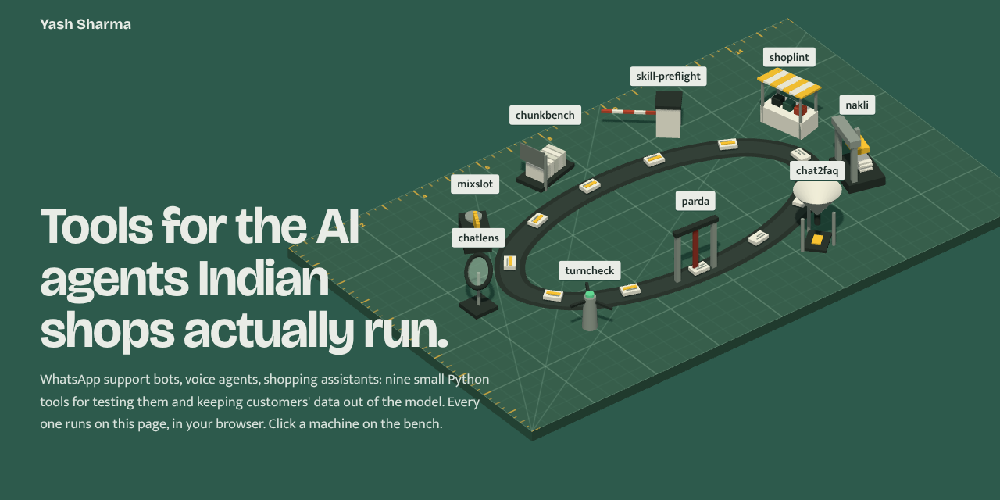

# yashere69.github.io

My portfolio page, at [yashere69.github.io](https://yashere69.github.io). It shows nine
Python tools I built for testing and hardening the AI agents small Indian businesses run,
and it runs all nine in the visitor's browser: each console on the page calls the tool's
real command-line entry point in [Pyodide](https://pyodide.org), not a recording.



## What's on the page

- **The bench.** A three.js scene of a cutting mat with a conveyor loop. Message cards go
  round it; when Python has loaded they carry real customer lines generated by nakli, and
  after the curtain (parda) their text is the redacted version. Hover a card to read it,
  click a machine to jump to that tool. The labels are ordinary buttons, so the bench works
  from the keyboard.
- **The line.** Type a message with a phone number, PAN or UPI id. parda redacts it, a
  "model" rewrites the tokens in a style you choose (parda's own benchmark transforms, no
  model is called), and the page shows parda's restore next to a plain find-and-replace.
- **Nine consoles.** One per tool, with the examples from its README. Some take your input
  (a message, a transcript, a SKILL.md, a scenario file). turncheck can't start a bot from a
  browser, so only `turncheck lint` runs; chatlens's labelling page is a local server, so
  its report, suggest and export commands run instead.

## How it's built

```
sources.toml ──> tools/build.py ──> dist/
  tool @ tag       clone each repo at its tag, build its wheel, copy its examples
  pyyaml sdist     pack PyYAML's pure-Python source (pinned sha256)
                   copy Pyodide's core files and the fonts from node_modules
                   bundle src/ with esbuild (three.js is code-split, loaded after the page)
                   write py/manifest.json: every file's sha256, each tool's commit
```

In the browser, `src/py-worker.js` starts Pyodide in a module worker, fetches each wheel,
checks its sha256 against the manifest and refuses to load it on a mismatch, then unpacks
it into site-packages. A console run writes the tool's example files and the visitor's
input into a fresh directory in Pyodide's in-memory filesystem and calls
`src/runner.py`'s `run_cli`, which imports `<tool>.cli` and calls `main(argv)` with stdout
and stderr captured.

Decisions worth knowing:

- **Nothing loads from another host.** Pyodide, three.js and the fonts are served from
  this site. The Content-Security-Policy is `default-src 'self'` with `wasm-unsafe-eval`
  for WebAssembly and nothing else, no `unsafe-eval` or inline scripts.
- **Python loads only when it's cheap.** On a fast connection with enough memory it
  starts in the background once the page is idle; otherwise it starts on the first run.
  The core download is about 10 MB, then cached.
- **No PyPI or CDN at runtime.** micropip would fetch from a CDN, so the build ships the
  wheels and the page unpacks them itself.
- **Real output, checked.** `tests/test_site.py` runs every console command in Chromium
  and in CPython with the same wheels and fails if stdout, stderr or the exit code
  differ. This caught two real bugs in the tools while the page was being built: parda
  skipped a phone number when the previous sentence mentioned an order (fixed in parda
  0.3.2), and chatlens `suggest` named groups by hash order, so output changed between
  runs (fixed in chatlens 0.3.2).

`#debug` at the end of the URL shows every request with its size, the frame rate and run
timings.

## Running it locally

Needs Node 22 and Python 3.12+.

```bash
npm ci
python tools/build.py                      # clones the tools from GitHub at their tags
python -m http.server -d dist 8000         # then open http://localhost:8000

# or build from local clones of the tools (the tags in sources.toml must exist there)
python tools/build.py --source-dir ../repos
```

Tests:

```bash
pip install -r requirements-test.txt dist/py/*.whl
python -m playwright install chromium
python -m pytest -q tests
```

The suite (44 tests, about a minute) covers the CPython comparison for every console and
for every rewrite style on the line, no requests to other hosts, no CSP violations, a
tampered wheel being refused, the page without WebGL, keyboard access from the bench,
an axe scan, small screens and reduced motion. CI runs it before every deploy.

`python tools/social_preview.py` re-renders `public/social-preview.png` from the built
page.

## Limits

- First load of Python is about 10 MB. On a slow connection, the consoles wait for it.
- The bench uses WebGL. Without it, the machine labels become a plain list and everything
  else works.
- Pyodide runs Python 3.14; the tools are tested on 3.11 to 3.13 in their own CI. The
  comparison tests are what cover the difference.
- `turncheck run` and `chatlens serve` need a subprocess and a local server, so they
  can't run here.

## Credits

The idea that a portfolio can be something you play with comes from
[Bruno Simon's](https://bruno-simon.com) portfolio; nothing here is taken from it. The
bench is built from boxes, cylinders and cones in code, without model files.
Typefaces: Bricolage Grotesque, Mukta (Ek Type) and IBM Plex Mono, all under the OFL.
Third-party licences are in `licenses.txt` on the site.

MIT licence.
